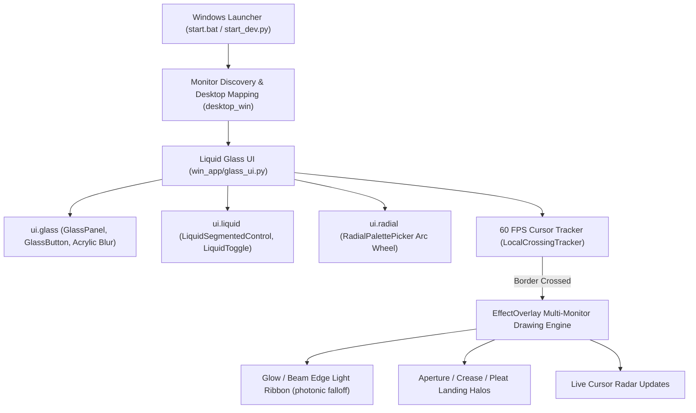

<div align="center">

# Crossfy — Smart Multi-Monitor Transition & Liquid Glass Animation Engine

<p align="center">
  <a href="README.tr.md">🇹🇷 Türkçe</a> • <b>🇺🇸 English</b>
</p>

<p align="center">
  <strong>A 60 FPS hardware-accelerated multi-monitor transition studio for Windows 10 and 11 that turns physical screen bezels into a living canvas of light.</strong><br>
  <em>Unite your displays into a single cohesive desktop: QPainter vector transition effects, fluid Liquid Glass styling, radial color dials, and a live cursor radar.</em>
</p>

<p align="center">
  <a href="LICENSE"></a>
  <a href="https://github.com/omerfys/Crossfy/stargazers"></a>
  <a href="https://www.python.org/"></a>
  <a href="https://wiki.qt.io/Qt_for_Python"></a>
  <a href="https://www.microsoft.com/windows"></a>
  
  
  
</p>

<br>

> **Crossfy** is an open-source modern desktop animation engine that transforms multi-monitor cursor transitions from a dull, instantaneous jump into a captivating visual spectacle. When your mouse cursor moves from one screen to another, it generates a ribbon of light and energy on the departing display while rendering a gentle landing halo on the arrival display. Everything is managed through a GPU-accelerated translucent **Liquid Glass** interface and futuristic radial control tools.

[Quick Start](#quick-start--installation) • [Features](#features) • [Panoramic Monitor Rig](#panoramic-monitor-rig--live-radar) • [Architecture](#architecture--operating-principles) • [Style Gallery](#supported-transition-styles) • [Turkish Overview (Türkçe)](#türkçe-özet-turkish-overview)

<br>

<div align="center">
  
  <p align="center"><em>▲ Crossfy Transition Studio: Hardware-accelerated Windows 11 Acrylic blur, live vector preview tiles, and fluid liquid capsule buttons</em></p>
</div>

---

</div>

## Table of Contents

- [Project Vision](#project-vision)
- [Features](#features)
- [Panoramic Monitor Rig & Live Radar](#panoramic-monitor-rig--live-radar)
- [Supported Transition Styles](#supported-transition-styles)
- [Radial Color Dial & Palettes](#radial-color-dial--palettes)
- [Architecture & Operating Principles](#architecture--operating-principles)
- [Liquid Glass Components](#liquid-glass-components-win_appui)
- [Quick Start & Installation](#quick-start--installation)
- [Frequently Asked Questions (FAQ)](#frequently-asked-questions-faq)
- [Turkish Overview (Türkçe)](#türkçe-özet-turkish-overview)
- [SEO Keywords (SEO Index)](#seo-keywords-seo-index)
- [License & Author](#license--author)

---

## Project Vision

A major friction point for multi-monitor users is the cursor getting lost as it leaps across screens, or the physical display borders feeling abrupt, rigid, and lifeless.

**Crossfy** reimagines this experience from the ground up:
1. **Organic Border Feel:** Display bezels are no longer static black borders. As the cursor nears and traverses a boundary, effects such as **Glow (neon radiance)** or **Beam (streaking laser beam)** bring edges to life.
2. **Customizable Aesthetics:** 9 distinct effect categories spanning optical camera lenses (Aperture) to pleated fabric waves (Pleat) and jacquard geometries.
3. **Smooth & Luxurious Photonic Decay:** In Luxurious mode, animations never terminate abruptly; they glide and fade gently following physical photon decay curves (`(1.0 - t)^2.2`).
4. **Liquid Glassmorphism:** Standard grey dialogs are replaced by an acrylic frosted-glass architecture that blurs the desktop wallpaper beneath at the GPU level.

---

## Features

- **60 FPS Hardware-Accelerated Transition Engine:**
  - Transparent full-desktop `EffectOverlay` canvas spanning all displays.
  - Pixel-precise coordinate mapping (`logical_point`).
  - Zero-latency (< 1 ms) monitor boundary crossing detection.
- **Live Vector Preview Tiles (`EffectStill`):**
  - Real-time 60 FPS preview playback triggered on hover (`TileHover`).
  - Dynamic toggling between Edge and Corner animation modes.
- **Fluid Liquid Capsule Controls:**
  - `LiquidSegmentedControl`: Quicksilver-smooth physical sliding curve (`QEasingCurve.OutCubic`).
  - Specular top glass highlight line and luminous neon selection indicator.
- **Radial Color Selection Dial (`RadialPalettePicker`):**
  - Custom circular arc slices rendered from scratch with `QPainterPath`.
  - Dynamic gradient bars and circular color swatch chips (`SwatchGroups`).
- **Panoramic Desk Rig & Cursor Radar:**
  - Accurate physical display workbench mirroring your desk configuration (Left ↔ Center ↔ Right).
  - Glowing cursor radar showing which monitor currently hosts the mouse pointer.
- **Windows 11 Native Acrylic & Dark Mode Integration:**
  - Real GPU desktop blur via `DwmExtendFrameIntoClientArea` and `SetWindowCompositionAttribute`.

---

## Panoramic Monitor Rig & Live Radar

Crossfy automatically discovers all connected displays and arranges them side-by-side matching your real desk orientation:

<div align="center">
  
  <p align="center"><em>▲ Physical layout of Left, Center (Primary), and Right monitors, transit bridges, and live cursor tracking radar</em></p>
</div>

- **Live Cursor Radar:** The card corresponding to the screen currently holding the cursor lights up instantly with a cyan neon boundary and displays the `● CURSOR ON THIS DISPLAY` badge.
- **Border Transit Bridges:** The `◄ ►` links between monitor cards indicate active inter-display crossing corridors.
- **Panoramic Metrics:** Total combined canvas resolution (e.g. `5760 x 1080 px`), active crossing pathways, and hardware latency reported in real time.

---

## Supported Transition Styles

<div align="center">
  
  <p align="center"><em>▲ Tuning panel: Duration (Snappy, Natural, Luxurious), Depth, and Refresh Rate parameters</em></p>
</div>

| Style Name | Category | Visual Behavior & Characteristics |
| :--- | :--- | :--- |
| **Glow** | Light | Deep, soft neon light banner radiating along the display border. |
| **Beam** | Light | Thin laser line and comet beam streaking rapidly along the edge. |
| **Aperture** | Light | Optical diaphragm lens that opens and softly closes at cursor entry. |
| **Crease** | Folio | Light fold that bends and creases organically along the screen edge. |
| **Pleat** | Folio | Accordion-like fabric folds undulating rhythmically. |
| **Concertina** | Folio | Harmonious multi-layered expanding transition effect. |
| **Thread** | Selvedge | Minimalist silky light filaments extending from the display boundary. |
| **Weave** | Selvedge | Organic dance of interlocking, colorful luminous fibers. |
| **Jacquard** | Selvedge | Intricately patterned geometric weave and landing halos. |

---

## Radial Color Dial & Palettes

<div align="center">
  
  <p align="center"><em>▲ Futuristic QPainterPath circular color wheel and gallery of 10 curated color themes</em></p>
</div>

- **Circular Color Wheel:** Click directly on color slices around the dial to switch color themes in seconds.
- **Curated Palettes:**
  - `Colourful` (Rainbow Spectrum)
  - `Ocean` (Ocean & Deep Cyan)
  - `Sunset` (Coral, Sunset & Fuchsia)
  - `Amethyst` (Dark Amethyst & Neon Violet)
  - `Emerald` (Vibrant Emerald & Mint Green)
  - `Sapphire` (Sapphire & Electric Blue)
  - `Sunstone` (Sunstone & Warm Amber)
  - `Signal` (Minimalist Neon Cyan)
  - `Topaz` & `Amber` (Gold & Warm Orange)

---

## Architecture & Operating Principles



---

## Liquid Glass Components (`win_app/ui/`)

Moving beyond standard Qt controls, the project relies on a bespoke vector rendering pipeline:

1. **`ui.glass` (Frosted Glass Engine):**
   - `apply_windows_acrylic`: Windows 11 DWM API (`DwmExtendFrameIntoClientArea` + `SetWindowCompositionAttribute`).
   - `GlassPanel`: Antialiased vector glass panels featuring top specular refraction lines.
   - `GlassButton`: Glass buttons rendering liquid light sheen on press and hover.
   - `GlassPill`: Sleek status badge with auto-scaling pixel geometry matching text width.
2. **`ui.liquid` (Liquid Animation Engine):**
   - `LiquidSegmentedControl`: Quicksilver sliding capsule gliding between options.
   - `LiquidToggle`: Sliding toggle switch with organic fluid morph animation.
   - `LiquidSlider`: Glass slider bar filled with luminous glowing liquid.
3. **`ui.radial` (Circular Dial Engine):**
   - `RadialPalettePicker`: Mathematically computed radial color wedges and center preview disc drawn with `QPainterPath.arcTo`.

---

## Quick Start & Installation

### Requirements
- **Operating System:** Windows 10 or Windows 11 (64-bit)
- **Python:** Python 3.11+ (Python 3.13 or 3.14 recommended)

### 1. Clone the Repository
```bash
git clone https://github.com/omerfys/Crossfy.git
cd Crossfy
```

### 2. Create Virtual Environment & Install Dependencies
```bash
python -m venv .venv
.\.venv\Scripts\pip install -r win_app/requirements-win.txt
```

### 3. One-Click Launch (Windows)
Double-click `start.bat` in the repository root to launch the application immediately:
```cmd
start.bat
```
*(or via PowerShell: `.\run.ps1`)*

### 4. Running in Developer Mode
```bash
.\.venv\Scripts\python.exe start_dev.py
```

---

## Frequently Asked Questions (FAQ)

**Does it work without multiple monitors?**
> Yes. You can open the studio on a single monitor, preview all live animations, and trigger test animations on screen with the preview button. However, the true panoramic experience unfolds when navigating your mouse across 2 or 3 screens.

**Does it strain the GPU or CPU?**
> Absolutely not. Crossfy only draws frames during the brief duration when the cursor crosses monitor boundaries. Idle CPU and GPU utilization is essentially **0%**.

**How do I drag the window?**
> To avoid accidental window dragging when interacting with sliders, dials, and buttons inside the body, dragging is anchored exclusively to the top glass title bar. Grab the title bar to move the window anywhere on your canvas.

**Can I open the classic KVM network interface?**
> Yes. Running in developer mode with the `start_dev.py --classic` flag will launch the classic multi-PC pairing windows.

---

## Türkçe Özet (Turkish Overview)

**Crossfy**, Windows 10 ve 11 için 60 FPS donanım hızlandırmalı modern bir çoklu monitör geçiş animasyon motorudur. Fare imlecinin ekranlar arasındaki sıradan atlamasını görsel bir ışık şölenine dönüştürür; GPU hızlandırmalı Liquid Glass arayüzü, radyal renk kadranı ve canlı imleç takip radarı sunar.

Ayrıntılı Türkçe dökümantasyon için [README.tr.md](README.tr.md) dosyasını inceleyebilirsiniz.

---

## SEO Keywords (SEO Index)

`Windows 11 Glassmorphism`, `Multi Monitor Cursor Transition`, `PySide6 Qt6 GUI`, `Edge Glow Effect`, `Liquid Glass UI`, `Monitor Crossing Animation`, `Acrylic Blur Behind`, `Windows Desktop Customization`, `Screen Border Effects`, `Python Desktop App`.

---

## License & Author

This project is licensed under the [GPL-3.0](LICENSE) License.

Developer & Design: **[omerfys](https://github.com/omerfys)**
</div>
