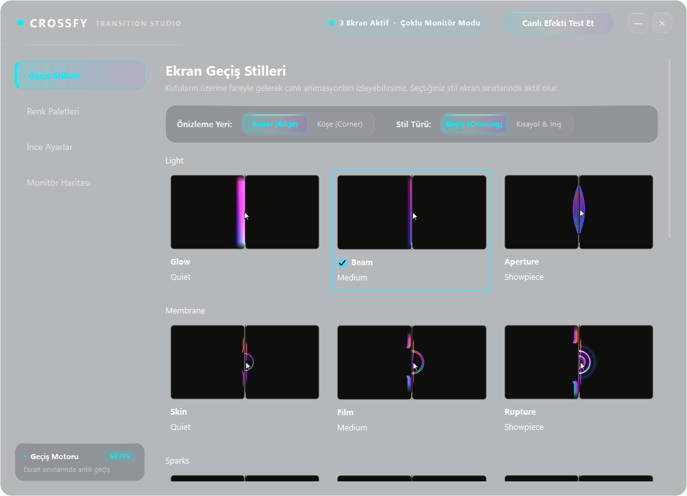
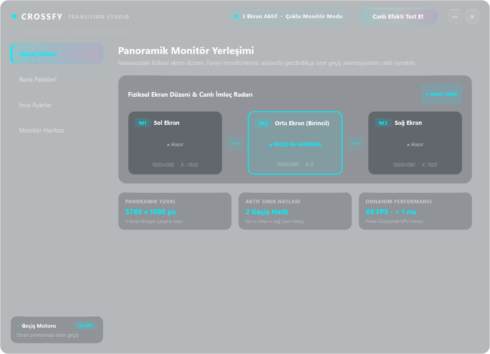
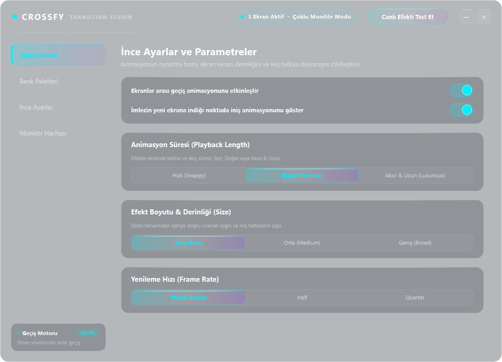
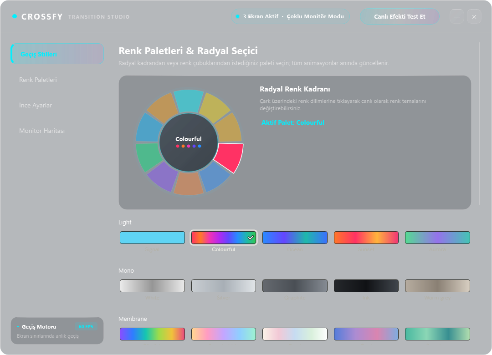
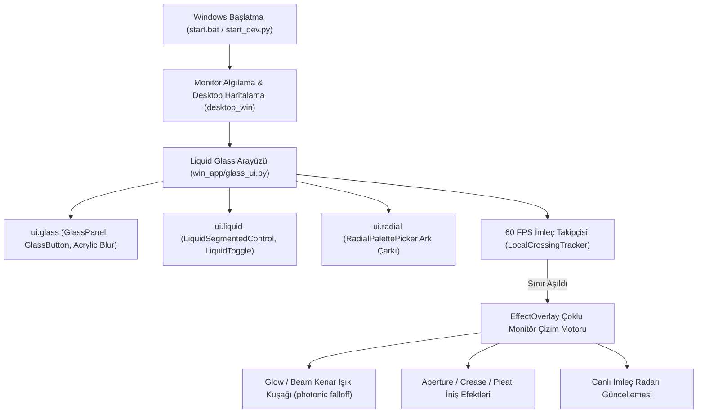

<div align="center">

# Crossfy — Akıllı Çoklu Monitör Geçiş & Liquid Glass Animasyon Motoru

<p align="center">
  <strong>Windows 10 ve 11 için 60 FPS donanım hızlandırmalı, fiziksel ekran sınırlarını yaşayan bir ışık tuvaline dönüştüren çoklu monitör geçiş stüdyosu.</strong><br>
  <em>Ekranlarınız tek bir masaüstü gibi birleşsin: QPainter vektörel geçiş efektleri, akıcı Liquid Glass tasarımı, radyal renk kadranı ve canlı imleç radarı.</em>
</p>

<p align="center">
  <a href="LICENSE"></a>
  <a href="https://github.com/omerfys/Crossfy/stargazers"></a>
  <a href="https://www.python.org/"></a>
  <a href="https://wiki.qt.io/Qt_for_Python"></a>
  <a href="https://www.microsoft.com/windows"></a>
  
  
  
</p>

<br>

> **Crossfy**, çoklu monitör kurulumlarında ekranlar arasındaki geçişleri sıradan bir imleç atlamasından çıkarıp görsel bir şölene dönüştüren açık kaynaklı modern bir masaüstü animasyon motorudur. Fare imleci bir monitörden diğerine geçtiğinde, ayrıldığı ekranda ışık ve enerji kuşağı oluştururken; ulaştığı ekranda ise yumuşak bir iniş halkası çizer. Tüm bunlar GPU hızlandırmalı yarı şeffaf **Liquid Glass** arayüzü ve fütüristik radyal kontrol araçlarıyla yönetilir.

[Hızlı Başlangıç](#hızlı-başlangıç--kurulum) • [Özellikler](#özellikler-features) • [Panoramik Monitör Düzeni](#panoramik-monitör-düzeni--canlı-radar) • [Mimari](#mimari--çalışma-prensibi) • [Stil Galerisi](#desteklenen-geçiş-stilleri) • [English Overview](#english-overview)

<br>

<div align="center">
  
  <p align="center"><em>▲ Crossfy Transition Studio: Donanım hızlandırmalı Windows 11 Acrylic buğulaması, canlı vektörel önizleme kutuları ve akıcı sıvı butonlar</em></p>
</div>

---

</div>

## İçindekiler (Table of Contents)

- [Proje Vizyonu](#proje-vizyonu)
- [Özellikler (Features)](#özellikler-features)
- [Panoramik Monitör Düzeni & Canlı Radar](#panoramik-monitör-düzeni--canlı-radar)
- [Desteklenen Geçiş Stilleri](#desteklenen-geçiş-stilleri)
- [Radyal Renk Kadranı & Paletler](#radyal-renk-kadranı--paletler)
- [Mimari & Çalışma Prensibi](#mimari--çalışma-prensibi)
- [Liquid Glass Bileşenleri](#liquid-glass-bileşenleri-win_appui)
- [Hızlı Başlangıç & Kurulum](#hızlı-başlangıç--kurulum)
- [Sıkça Sorulan Sorular (FAQ)](#sıkça-sorulan-sorular-faq)
- [English Overview](#english-overview)
- [SEO Anahtar Kelimeler (SEO Index)](#seo-anahtar-kelimeler-seo-index)
- [Lisans & Yazar](#lisans--yazar)

---

## Proje Vizyonu

Çoklu monitör kullanıcılarının en büyük sorunlarından biri, imlecin bir ekrandan diğerine geçerken gözden kaybolması veya monitör sınırlarının donuk, keskin ve hissiz kalmasıdır.

**Crossfy**, bu deneyimi baştan aşağı yeniden tasarlar:
1. **Organik Sınır Hissi:** Ekran sınırları artık siyah çerçevelerden ibaret değildir. İmleç sınıra yaklaştığında ve geçtiğinde **Glow (neon parlama)** veya **Beam (kayan lazer demeti)** gibi efektlerle sınır canlanır.
2. **Kişiselleştirilebilir Estetik:** Optik lenslerden (Aperture) plili kumaş dalgalarına (Pleat) ve jakarlı geometrilere kadar 9 farklı efekt grubu sunulur.
3. **Akıcı ve Uzun Işık Yayılımı (Photonic Decay):** Akıcı ve Uzun modunda efektler sert bir şekilde kesilmez; fiziksel foton sönümleme eğrileriyle (`(1.0 - t)^2.2`) yumuşacık bir şekilde süzülerek solar.
4. **Liquid Glassmorphism:** Menüler standart gri pencereler yerine arkadaki masaüstü duvar kâğıdını GPU seviyesinde flulaştıran saf buzlu cam akrilik mimariye sahiptir.

---

## Özellikler (Features)

- **60 FPS Donanım Hızlandırmalı Geçiş Motoru:**
  - Tüm masaüstünü kaplayan şeffaf `EffectOverlay` katmanı.
  - Piksel düzeyinde koordinat haritalama (`logical_point`).
  - Gecikmesiz (< 1 ms) monitör sınır geçiş tespiti.
- **Canlı Vektörel Önizleme Kutuları (`EffectStill`):**
  - Fare kutuların üzerine geldiğinde (`TileHover`) gerçek zamanlı 60 FPS önizleme oynatımı.
  - Kenar (*Edge*) ve Köşe (*Corner*) modları arasında dinamik geçiş.
- **Akıcı Sıvı (Liquid) Kapsül Butonlar:**
  - `LiquidSegmentedControl`: Cıva gibi akıcı fiziksel kayma eğrisi (`QEasingCurve.OutCubic`).
  - Üst cam yansıma çizgisi ve parlayan neon seçim göstergesi.
- **Radyal Renk Seçim Kadranı (`RadialPalettePicker`):**
  - `QPainterPath` ile sıfırdan çizilen dairesel ark dilimleri.
  - Canlı gradyan çubukları ve dairesel renk çipleri (`SwatchGroups`).
- **Panoramik Masaüstü & İmleç Radarı:**
  - Masadaki fiziksel monitör sırasını (Sol ↔ Orta ↔ Sağ) birebir gösteren görsel tezgâh.
  - Farenin o an hangi ekranda olduğunu canlı parlayarak gösteren imleç radarı.
- **Windows 11 Native Acrylic & Dark Mode Entegrasyonu:**
  - `DwmExtendFrameIntoClientArea` ve `SetWindowCompositionAttribute` ile GPU seviyesinde gerçek masaüstü buğusu.

---

## Panoramik Monitör Düzeni & Canlı Radar

Crossfy, sisteminize bağlı tüm ekranları tespit ederek masanızdaki fiziksel dizilimiyle yan yana görselleştirir:

<div align="center">
  
  <p align="center"><em>▲ Sol, Orta (Birincil) ve Sağ monitörlerin fiziksel yerleşimi, geçiş köprüleri ve canlı imleç takip radarı</em></p>
</div>

- **Canlı İmleç Radarı:** Fare imleciniz hangi ekrandaysa, o ekrana ait kart anında cyan neon sınırla parlar ve `● İMLEÇ BU EKRANDA` bildirimini gösterir.
- **Sınır Geçiş Hatları:** Monitörler arasındaki `◄ ►` köprüleri ekranlar arası aktif geçiş kanallarını belirtir.
- **Panoramik Metrikler:** Toplam birleşik tuval çözünürlüğü (örneğin `5760 x 1080 px`), aktif hat sayısı ve donanım gecikmesi gerçek zamanlı raporlanır.

---

## Desteklenen Geçiş Stilleri

<div align="center">
  
  <p align="center"><em>▲ İnce ayar paneli: Süre (Hızlı, Doğal, Akıcı & Uzun), Derinlik ve Yenileme Hızı parametreleri</em></p>
</div>

| Stil Adı | Kategori | Görsel Davranış ve Nitelik |
| :--- | :--- | :--- |
| **Glow** | Light | Ekran sınırında parlayan derin, yumuşak neon ışık kuşağı. |
| **Beam** | Light | Sınır boyunca hızla kayan ince lazer çizgisi ve kuyruklu yıldız demeti. |
| **Aperture** | Light | İmlecin girdiği noktada açılan ve yumuşakça kapanan optik diyafram lensi. |
| **Crease** | Folio | Ekran sınırında organik olarak bükülen ve katlanan ışık katmanı. |
| **Pleat** | Folio | Ritmik bir biçimde dalgalanan akordeon kumaş kıvrımları. |
| **Concertina** | Folio | Ahenkle genişleyen çok katmanlı harmonik geçiş efekti. |
| **Thread** | Selvedge | Ekran sınırından uzanan minimalist, ipeksi ışık iplikleri. |
| **Weave** | Selvedge | Birbirine kenetlenen renkli liflerin organik dansı. |
| **Jacquard** | Selvedge | Zarif desenli geometrik dokuma ve iniş halkaları. |

---

## Radyal Renk Kadranı & Paletler

<div align="center">
  
  <p align="center"><em>▲ Fütüristik QPainterPath dairesel renk çarkı ve 10 özgün renk paleti galerisi</em></p>
</div>

- **Dairesel Renk Çarkı:** Çark üzerindeki renk dilimlerine tıklanarak saniyeler içinde renk teması değiştirilebilir.
- **Koleksiyon Paletleri:**
  - `Colourful` (Gökkuşağı Tayfı)
  - `Ocean` (Okyanus & Derin Camgöbeği)
  - `Sunset` (Mercan, Günbatımı & Fuşya)
  - `Amethyst` (Koyu Ametist & Neon Menekşe)
  - `Emerald` (Parlak Zümrüt & Nane Yeşili)
  - `Sapphire` (Safir & Elektrik Mavisi)
  - `Sunstone` (Güneştaşı & Sıcak Amber)
  - `Signal` (Minimalist Neon Camgöbeği)
  - `Topaz` & `Amber` (Altın & Sıcak Turuncu)

---

## Mimari & Çalışma Prensibi



---

## Liquid Glass Bileşenleri (`win_app/ui/`)

Proje, standart Qt bileşenlerinin ötesine geçerek tamamen özel çizim motoruna dayanır:

1. **`ui.glass` (Buzlu Cam Motoru):**
   - `apply_windows_acrylic`: Windows 11 DWM API (`DwmExtendFrameIntoClientArea` + `SetWindowCompositionAttribute`).
   - `GlassPanel`: Antialiasing destekli, üstten ışık kırılmalı vektörel cam paneller.
   - `GlassButton`: Basma ve üzerine gelme anında sıvı parıltısı veren cam butonlar.
   - `GlassPill`: Metin uzunluğuna göre pikselleri otomatik ölçeklenen şık durum rozeti.
2. **`ui.liquid` (Sıvı Animasyon Motoru):**
   - `LiquidSegmentedControl`: İki veya daha fazla seçenek arasında cıva gibi süzülen kayar kapsül.
   - `LiquidToggle`: Organik sıvı geçiş animasyonuna sahip kayar anahtar.
   - `LiquidSlider`: Parlayan sıvı dolgulu cam kaydırma çubuğu.
3. **`ui.radial` (Dairesel Kadran Motoru):**
   - `RadialPalettePicker`: `QPainterPath.arcTo` ile matematiksel olarak hesaplanan radyal renk dilimleri ve merkez önizleme diski.

---

## Hızlı Başlangıç & Kurulum

### Gereksinimler
- **İşletim Sistemi:** Windows 10 veya Windows 11 (64-bit)
- **Python:** Python 3.11+ (Python 3.13 veya 3.14 önerilir)

### 1. Depoyu Klonlayın
```bash
git clone https://github.com/omerfys/Crossfy.git
cd Crossfy
```

### 2. Sanal Ortamı Kurun ve Bağımlılıkları Yükleyin
```bash
python -m venv .venv
.\.venv\Scripts\pip install -r win_app/requirements-win.txt
```

### 3. Tek Tıkla Başlatın (Windows)
Klasördeki `start.bat` dosyasına çift tıklayarak uygulamayı anında başlatabilirsiniz:
```cmd
start.bat
```
*(veya PowerShell ile `.\run.ps1`)*

### 4. Geliştirici Modunda Çalıştırma
```bash
.\.venv\Scripts\python.exe start_dev.py
```

---

## Sıkça Sorulan Sorular (FAQ)

**Birden fazla monitörüm olmadan çalışır mı?**
> Evet, tek monitörde de stüdyoyu açabilir, tüm canlı efektleri önizleyebilir ve test butonuyla ekranınızda oynatabilirsiniz. Ancak asıl deneyim farenizi 2 veya 3 monitör arasında gezdirdiğinizde ortaya çıkar.

**Ekran kartını veya işlemciyi yorar mı?**
> Kesinlikle hayır. Crossfy yalnızca imleç ekran sınırlarını aştığı anlarda çizim yapar; bekleme anında CPU ve GPU tüketimi **%0** civarındadır.

**Pencereyi nasıl sürüklerim?**
> Pencere gövdesindeki butonlara basıldığında yanlışlıkla kaymaması için sürükleme hareketi yalnızca en üstteki cam başlık çubuğuna bağlanmıştır. Başlıktan tutarak dilediğiniz gibi taşıyabilirsiniz.

**Orijinal KVM ağ arayüzünü açabilir miyim?**
> Evet. Geliştirici modunda `start_dev.py --classic` parametresini kullanarak orijinal çoklu bilgisayar eşleşme pencerelerine ulaşabilirsiniz.

---

## English Overview

**Crossfy** is a modern, hardware-accelerated multi-monitor crossing animation engine and design studio for Windows 10 and 11. Instead of mundane, instantaneous cursor jumping between displays, Crossfy turns the physical seams of your multi-monitor setup into a living canvas of light.

### Key Highlights
- **60 FPS Hardware Acceleration:** Driven by PySide6, `QPainter`, and Windows 11 DWM Acrylic blur.
- **Liquid Glass Interface:** Designed from scratch with frosted glass transparency, specular highlights, and fluid segmented controls.
- **Radial Color Dial:** Circular interactive color picker drawn with mathematical `QPainterPath` arc geometry.
- **Panoramic Desk Rig:** Accurately mirrors your real physical multi-monitor desk arrangement with a live cursor radar indicator.
- **Rich Effect Arsenal:** Glow, Beam, Aperture, Crease, Pleat, Concertina, Thread, Weave, and Jacquard.
- **Smooth Photonic Decay:** Natural quadratic falloff curves (`(1.0 - t)^2.2`) ensuring transitions taper off gracefully in Luxurious mode.

---

## SEO Anahtar Kelimeler (SEO Index)

`Windows 11 Glassmorphism`, `Multi Monitor Cursor Transition`, `PySide6 Qt6 GUI`, `Edge Glow Effect`, `Liquid Glass UI`, `Monitor Crossing Animation`, `Acrylic Blur Behind`, `Windows Desktop Customization`, `Screen Border Effects`, `Python Desktop App`.

---

## Lisans & Yazar

Bu proje [GPL-3.0](LICENSE) lisansı altında sunulmaktadır.

Geliştirici & Tasarım: **[omerfys](https://github.com/omerfys)**
</div>
